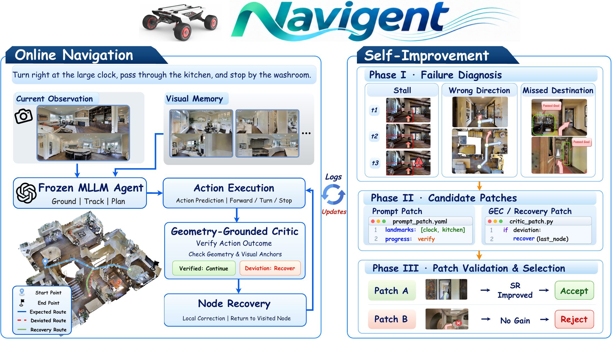

<h1 align="center">
  Navigent: A Geometry-Grounded Agentic Framework for Vision Language Navigation
</h1>

<p align="center">
  <a href="https://marslab-navigent.github.io/navigent.github.io/"></a>
  <a href="https://arxiv.org/pdf/2611.34249"></a>
</p>

<p align="center">
  <a href="https://marslab-navigent.github.io/navigent.github.io/#teaser"></a>
  <br><sub>▶ Click to watch the teaser video on the project page</sub>
</p>

## 🧭 Overview

**Navigent** is an embodied navigation agent built around a frozen multimodal language model. A forward command can fall short, and a robot can pass a relevant doorway without noticing. Navigent checks both the motion it executed and its progress relative to visual landmarks.


## 🤖 Method

- **Visual memory.** The agent reasons from the instruction, current observations, and sampled earlier views.
- **Geometry-grounded execution.** The critic compares commanded motion with measured displacement and tracks selected visual anchors in world coordinates.
- **Node-based recovery.** When execution and observations disagree, the agent can inspect the scene, adjust its motion, or return along the recorded route to a visited node.



## 📊 Results

Comparison on the Habitat **val-unseen** splits of R2R-CE and RxR-CE. NE is in meters; OSR, SR, SPL, and nDTW are percentages. **Bold** marks the best result and <ins>underline</ins> the best baseline.

<table>
  <thead>
    <tr><th rowspan="2" align="left">Method</th><th colspan="4">R2R-CE val-unseen</th><th colspan="4">RxR-CE val-unseen</th></tr>
    <tr><th>NE ↓</th><th>OSR ↑</th><th>SR ↑</th><th>SPL ↑</th><th>NE ↓</th><th>SR ↑</th><th>SPL ↑</th><th>nDTW ↑</th></tr>
  </thead>
  <tbody>
    <tr><td colspan="9"><i>VLA / end-to-end navigation models</i></td></tr>
    <tr><td>NaVid</td><td align="center">5.47</td><td align="center">49.1</td><td align="center">37.4</td><td align="center">35.9</td><td align="center">8.41</td><td align="center">23.8</td><td align="center">21.2</td><td align="center">–</td></tr>
    <tr><td>NaVILA</td><td align="center">5.22</td><td align="center">62.5</td><td align="center">54.0</td><td align="center">49.0</td><td align="center">6.77</td><td align="center">49.3</td><td align="center">44.0</td><td align="center">58.8</td></tr>
    <tr><td>Uni-NaVid</td><td align="center">5.58</td><td align="center">53.5</td><td align="center">47.0</td><td align="center">42.7</td><td align="center">6.24</td><td align="center">48.7</td><td align="center">40.9</td><td align="center">–</td></tr>
    <tr><td>StreamVLN</td><td align="center">4.90</td><td align="center">63.6</td><td align="center">56.4</td><td align="center">50.2</td><td align="center">5.65</td><td align="center">54.4</td><td align="center">45.4</td><td align="center">63.7</td></tr>
    <tr><td>NavFoM</td><td align="center">4.61</td><td align="center">72.1</td><td align="center">61.7</td><td align="center">55.3</td><td align="center">4.74</td><td align="center">64.4</td><td align="center">56.2</td><td align="center">65.8</td></tr>
    <tr><td>CorrectNav</td><td align="center">4.24</td><td align="center">67.5</td><td align="center">65.1</td><td align="center">62.3</td><td align="center">4.09</td><td align="center">69.3</td><td align="center"><ins>63.3</ins></td><td align="center"><ins>75.2</ins></td></tr>
    <tr><td>OmniNav</td><td align="center"><ins>3.74</ins></td><td align="center"><ins>74.6</ins></td><td align="center"><ins>69.5</ins></td><td align="center"><ins>66.1</ins></td><td align="center"><ins>3.77</ins></td><td align="center"><ins>73.6</ins></td><td align="center">62.0</td><td align="center">–</td></tr>
    <tr><td colspan="9"><i>Agentic / training-free MLLM methods</i></td></tr>
    <tr><td>InstructNav</td><td align="center">6.90</td><td align="center">–</td><td align="center">31.0</td><td align="center">24.0</td><td align="center">–</td><td align="center">–</td><td align="center">–</td><td align="center">–</td></tr>
    <tr><td>NavGPT-CE</td><td align="center">8.40</td><td align="center">26.9</td><td align="center">16.3</td><td align="center">10.2</td><td align="center">–</td><td align="center">–</td><td align="center">–</td><td align="center">–</td></tr>
    <tr><td>CA-Nav</td><td align="center">7.58</td><td align="center">48.0</td><td align="center">25.3</td><td align="center">10.8</td><td align="center">10.37</td><td align="center">19.0</td><td align="center">6.0</td><td align="center">13.5</td></tr>
    <tr><td>GC-VLN</td><td align="center">7.30</td><td align="center">41.8</td><td align="center">33.6</td><td align="center">16.3</td><td align="center">8.80</td><td align="center">33.8</td><td align="center">13.8</td><td align="center">–</td></tr>
    <tr><td>HarnessVLN</td><td align="center">4.08</td><td align="center">70.7</td><td align="center">59.6</td><td align="center">43.6</td><td align="center">6.50</td><td align="center">51.4</td><td align="center">38.1</td><td align="center">55.6</td></tr>
    <tr><td>AgentVLN</td><td align="center">3.88</td><td align="center">73.5</td><td align="center">67.2</td><td align="center">64.7</td><td align="center">3.92</td><td align="center">69.5</td><td align="center">61.3</td><td align="center">74.6</td></tr>
    <tr><td><b>Navigent (Ours)</b></td><td align="center"><b>2.22</b></td><td align="center"><b>86.1</b></td><td align="center"><b>84.0</b></td><td align="center"><b>72.9</b></td><td align="center"><b>1.92</b></td><td align="center"><b>86.0</b></td><td align="center"><b>69.1</b></td><td align="center"><b>79.7</b></td></tr>
  </tbody>
</table>

On real hardware (AgileX SCOUT MINI with an Intel RealSense D456), Navigent completes **27 of 30** indoor and outdoor trials (**90.0% SR**).

## 🛠️ Evaluation

Use Python 3.9, Habitat-Sim 0.2.4 (`headless`), a compatible Habitat-Lab installation, and the dependencies in `requirements.txt`. For a Habitat source checkout, set `HABITAT_LAB_PATH` to the checkout root. Model inference uses an authenticated Codex CLI on `PATH` (or `NAV_CODEX_BIN`).

Supply the Matterport3D scene directory and a Habitat-format R2R-CE or RxR-CE episode file. Both benchmarks use the same entry point; change `DATASET` to evaluate RxR-CE.

```bash
DATASET=/path/to/val_unseen.json.gz
SCENES=/path/to/scene_datasets

python -m pip install -r requirements.txt
python scripts/make_registration.py --dataset "$DATASET" --split val_unseen --output registration.json
python -m eval --registration registration.json --data-path "$DATASET" \
  --scenes-dir "$SCENES" --episode all --gpu 0 --output-root outputs/val_unseen
```

This repository contains the evaluation runtime; benchmark data and scene assets are not bundled. See [NOTICE](NOTICE) for third-party attribution.
