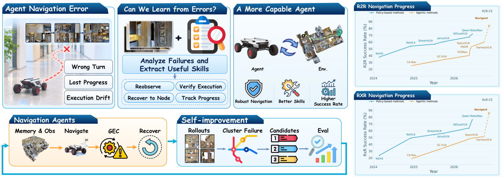
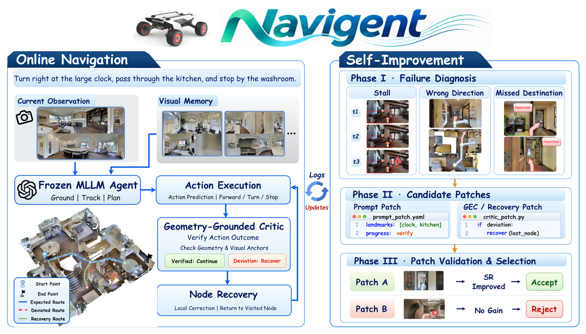

<h1 align="center">
  Navigent: A Geometry-Grounded Agentic Framework for Vision Language Navigation
</h1>

<p align="center">
  <a href="https://marslab-navigent.github.io/navigent.github.io/"></a>
  <span aria-disabled="true"></span>
</p>


## 🧭 Overview

**Navigent** is an embodied navigation agent built around a frozen multimodal language model. A forward command can fall short, and a robot can pass a relevant doorway without noticing. Navigent checks both the motion it executed and its progress relative to visual landmarks.



## 🤖 Method

- **Visual memory.** The agent reasons from the instruction, current observations, and sampled earlier views.
- **Geometry-grounded execution.** The critic compares commanded motion with measured displacement and tracks selected visual anchors in world coordinates.
- **Node-based recovery.** When execution and observations disagree, the agent can inspect the scene, adjust its motion, or return along the recorded route to a visited node.



## 📊 Results

Navigent results on the Habitat **val-unseen** splits. NE is in meters; OSR, SR, SPL, and nDTW are percentages.

### R2R-CE

| Episodes | NE ↓ | OSR ↑ | SR ↑ | SPL ↑ |
| ---: | ---: | ---: | ---: | ---: |
| 1,839 | **2.22** | **86.1** | **84.0** | **72.9** |

### RxR-CE

| Episodes | NE ↓ | SR ↑ | SPL ↑ | nDTW ↑ |
| ---: | ---: | ---: | ---: | ---: |
| 3,669 | **1.92** | **86.0** | **69.1** | **79.7** |

## 🛠️ Evaluation

Use Python 3.9, Habitat-Sim 0.2.4 (`headless`), a compatible Habitat-Lab installation, and the dependencies in `requirements.txt`. For a Habitat source checkout, set `HABITAT_LAB_PATH` to the checkout root. Model inference uses an authenticated Codex CLI on `PATH` (or `NAV_CODEX_BIN`).

Supply the Matterport3D scene directory and a Habitat-format R2R-CE or RxR-CE episode file. Both benchmarks use the same entry point; change `DATASET` to evaluate RxR-CE.

```bash
DATASET=/path/to/val_unseen.json.gz
SCENES=/path/to/scene_datasets

python -m pip install -r requirements.txt
python scripts/make_registration.py --dataset "$DATASET" --split val_unseen --output registration.json
python -m eval --registration registration.json --data-path "$DATASET" \
  --scenes-dir "$SCENES" --episode all --gpu 0 --output-root outputs/val_unseen
```

This repository contains the evaluation runtime; benchmark data and scene assets are not bundled. See [NOTICE](NOTICE) for third-party attribution.
